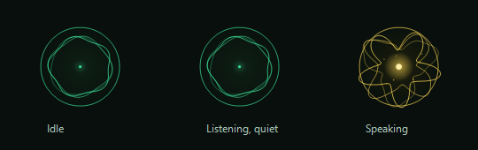

# CODEX Voice Control

**Hands-free Windows voice control for Codex's native dictation.** Say **Hello Codex**, speak in Bengali, English or any language supported by your Codex app, then pause and say **Send**. Your words are transcribed by Codex itself.

Version **0.4.1** · Windows x64 · Free use · Independent community companion



[বাংলা নির্দেশনা](docs/README.bn.md) · [Quick start](QUICKSTART.txt) · [Changes](CHANGELOG.md) · [License](LICENSE.txt)

## Install

Run the **Windows-x64-Setup.exe** and open **CODEX Voice Control** from the desktop. For portable use, extract the ZIP to a writable folder and run `CODEX.exe`. [Downloads and SHA-256 checksums](https://github.com/Azfar99/codex-voice-control/releases/latest).

Requirements: Windows 10 1809+ or Windows 11 x64, .NET Framework 4.7.2+, and a compatible installed OpenAI desktop app with **Codex mode and native Dictate available**. Sign in to your own account. Windows **English (United States) speech recognition** is needed for the small command vocabulary. Without it, click Record instead. Codex's account, microphone and network requirements still apply.

Setup detects the current user's installed OpenAI package. No author's account, password, API key, Python environment, Whisper model or transcription service is included. The companion does not install Codex or sign you in.

## Speak, review, send

| Say or do | Result |
| --- | --- |
| `Hello Codex`, `Okay Codex`, `Hey Codex` | Start Codex's own dictation |
| Speak normally | Codex records/transcribes your message; the orb responds to microphone energy |
| Pause **at least two seconds**, then say `Stop` or `থামো` alone | Finish dictation and keep the draft |
| Click the small arrow | Read a copy of the actual Codex draft |
| `Start` or `Okay start` | Add more native dictation in the selected chat |
| Pause **at least two seconds**, then say `Send` or `Run` alone | Send the draft once; if recording, finish dictation first |
| Click orb / drag orb | Record or Stop / move the control |
| Right-click | Resize, hide, pause the command mic, choose startup, or **Stop completely** |
| `Ctrl+Alt+D` / `Ctrl+Alt+Escape` | Manual Record/Stop / pause mic and cancel pending send |

Additional wake phrases: `হ্যালো কোডেক্স`, `ওকে কোডেক্স`, `কোডেক্স আসো`, `কোডেক্স আছো`, `কোডেক্স কি তুমি আছো`, `আচ্ছা কোডেক্স শোনো`. These short Bengali commands use custom pronunciations in the Windows English recognizer; accent accuracy can vary. Full-message transcription always belongs to Codex.

Ordinary mentions of “stop”, “send” and “run” inside a sentence are ignored. A command needs a quiet gap **before** it and must not continue into more speech. Direct voice Send also requires a final Send/Run word in the native transcript; an uncertain result leaves the draft for review.

**The companion does not focus Codex to edit your draft.** If Codex transcribes the final Stop/Send word, it can remain in the message. Preview shows the actual text, including that word. Automatically removing it previously required bringing the editor forward, so that editing path has been removed.

## Desktop behavior and privacy

The small orb stays behind other windows when idle and appears above them during an active session. Idle/quiet is green; speech makes the frame, waves and particles yellow with stronger outward motion. Size defaults to 76 px, with smaller/larger menu options.

The companion makes the background Codex window transparent before operating its native buttons. A minimized Codex window stays minimized between operations. The companion restores the previous app's focus if Codex takes it while processing a button action. Use **Show Codex** when you want the full window.

Keep a Codex chat open in the background or minimized. If Codex has fully quit, the companion asks you to open it manually before voice dictation can start. This avoids the startup flash from launching the full app on wake. After you send a prompt, use the desktop app's **Settings > Notifications** to choose when Codex shows turn completion alerts. [OpenAI desktop settings](https://learn.chatgpt.com/docs/app/settings#notifications).

**Stop completely** closes the command microphone and companion process, and removes its login startup entry. Double-click the desktop shortcut to restart manually. Startup stays off until you enable it in the menu. Hiding only the orb keeps the tray and microphone running.

The companion saves preferences and small bounded diagnostic logs beside the executable in `data/`. It does **not** save microphone recordings or message transcripts to disk. Logs contain command type, confidence, timing and errors. Native dictation data is handled by the OpenAI app under its own settings and terms.

## Performance and validation

The implementation is native **C# / .NET Framework / WinForms / GDI+**, with Windows **System.Speech** for short commands and **UI Automation** for verified native buttons. No separate transcription model runs in the companion.

In the same local read benchmark, cached preview reads improved from **48 ms to 2 ms median**. The preview polling interval changed from 1000 ms to 250 ms and runs only while its panel is open. Short-command endpoint settings, transition polling, renderer allocations and hidden/covered drawing were also reduced. These do not accelerate Codex's own transcription service. Fresh idle memory was about **77 MiB working set / 39 MiB private** on the test PC; this is not a memory ceiling. The full Codex app consumes additional memory.

On the test PC, repeated Record/Stop checks with Codex minimized and behind another app retained the original foreground app and draft. The window monitor observed no visible Codex popup. The command and installer checks also passed. Previous user tests confirmed native dictation and direct Send. Compatibility with other PCs, accents and future Codex versions varies.

## Build and publish

Run from PowerShell 7 on Windows with the .NET Framework compiler and Windows speech components:

```powershell
.\build.ps1
.\CODEX.exe --voice-self-test
.\CODEX.exe --bridge-check
.\installer\get-build-tool.ps1
.\installer\package.ps1
```

Close the companion before compiling (`CODEX.exe --shutdown`). Packages, SHA-256 checksums and a source-file manifest are written to `releases/`. The source ZIP excludes user data, logs, build tools and scratch files. [Installer details](installer/README.md) · [GitHub publishing and discoverability](docs/GITHUB-PUBLISH.md).

## License and attribution

Copyright © 2026 **Azfar99**. Downloading, using, modifying your own copy and sharing free copies are allowed with copyright credit and the required notices. Selling the software or providing a paid software service requires a separate written agreement. No license key, download fee or automatic royalty is required. This is a **custom free-use/source-available license**, not MIT or an OSI open-source license; read [LICENSE.txt](LICENSE.txt).

This project is independent of OpenAI and is not an official OpenAI product. Setup is unsigned. Third-party requirements and terms are listed in [THIRD-PARTY-NOTICES.txt](THIRD-PARTY-NOTICES.txt).
